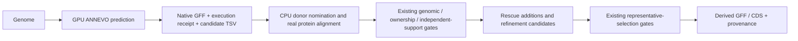

# ANNEVO candidates in rescue and refinement

ANNEVO's independent genome prediction can supplement missing-gene rescue and
existing-locus refinement. This is opt-in; original GFF/CDS/genomes stay unchanged.
Predictions are candidates, not independent biological support or calibrated
annotation-confidence scores.



## Prepare and connect

Run [ANNEVO genome annotation](annevo-genome-annotation.md) once. Each species
exports `output/genome_prediction/annevo/SPECIES/candidate_inputs.tsv`. This
table contains `species`, `gff`, `receipt`, in that order. For several species,
combine their rows under one header; do not rename species or overwrite sources.
Paths must be accessible inside the same GG container, and relative paths are
resolved against the table's directory.

An existing native prediction can export the same table:

```bash
python workflow/support/annevo_gene_models.py \
  --species Aethionema_arabicum --genome /data/genome.fa \
  --gff /data/native.gff3 --receipt /data/native_prediction.json \
  --output /data/annevo_candidates.tsv
```

Set `gene_model_annevo_inputs` in the input-generation entrypoint, or use:

```bash
GG_INPUT_GENE_MODEL_ANNEVO_INPUTS=/data/annevo_candidates.tsv \
GG_INPUT_RUN_GENE_MODEL_RESCUE=1 \
GG_INPUT_RUN_GENE_MODEL_REFINEMENT=1 \
  bash workflow/gg_input_generation_entrypoint.sh
```

The independent `rescue_gene_models.py plan` and `gene_model_refinement.py plan`
commands also accept `--annevo-inputs`. Refinement inherits a frozen ANNEVO table
when consuming a completed rescue publication; an explicit table is revalidated
against the current sources. Blank input leaves ordinary prediction unchanged.
The rescue/refinement workers consume GFF/receipts and need no GPU or ANNEVO
installation. Scheduler resources remain explicit and unchanged.

## Admission and restart

- Import only successful GG native GPU prediction receipts for the six supported
  [ANNEVO model profiles](annevo-genome-annotation.md#select-a-model-automatically)
  and nuclear genetic code 1. Newly supported profiles must retain their matching
  native inference lineage; legacy Magnoliopsida receipts remain valid. Freeze
  table/GFF/receipt hashes with the plan; verify them at fresh boundaries and
  before publication.
- The prediction must use the target assembly. New native receipts additionally
  bind sorted contig names, lengths and DNA sequence hashes, allowing gzip,
  description, wrapping, ordering and letter-case differences without allowing
  changed contig names or bases. Legacy receipts require exact input bytes.
- Compare native coding paths only inside existing nominated intervals or
  bounded real miniprot placements. Measure protein identity and reciprocal
  coverage against the actual donor; apply the existing coverage/identity
  thresholds and alignment/candidate-size bounds. No score is fabricated from
  ANNEVO agreement or an available model.
- Keep existing ORF/start/stop, phase, splice, ambiguity, protected-exception,
  copy/ownership and independent-species checks. Unanchored placements retain
  their two-species minimum; several predictors/isoforms from one species count
  once. Split/merged or conflicting loci remain proposals.
- Existing intact loci retain `rna_required` representative admission by default.
  Accepted candidates and chosen representatives remain separate decisions.
  Whole coding RNA paths use the existing `gene_model_refinement_rna` interface;
  missing expression in the sampled tissues is not a gene-loss call.
- Confirm each ANNEVO donor comparison against that exact donor query's actual
  genomic transfer. Existing-locus refinement needs the same internal junctions
  and frame-compatible coding overlap; unanchored new-gene rescue needs the
  complete coding path including both termini. ANNEVO cannot corroborate itself.
  Whole coding RNA can confirm refinement structure without miniprot agreement.
- An incomplete source ORF does not invalidate its retained exons or complete
  termini. Displacing those coordinates needs whole-path target RNA support;
  restoring missing exons and extending incomplete termini remains allowed.
  This gate also applies to ordinary homology refinement. Explicit
  `conservation_supported` admission retains its existing intact-locus behavior.
- Competing ANNEVO-supported paths without a decisive existing donor rank stay
  unresolved. They cannot become a published model through the longest-path
  fallback. Protein-only PairScore fields remain readable, but
  `junction_information_available=false` marks their unavailable donor structure;
  they are not splice-confirmation evidence.
- Copy ambiguity from the final representative-selection graph also gates
  publication. Homology-only candidates at ambiguous loci remain in the
  prediction/catalog audit and `unpublished_candidates.json`; they are omitted
  from both active `full_annotation` and its paired `all_candidates` CDS file.
  Original sources, exact-coordinate repairs and complete RNA-confirmed paths
  keep their own evidence and publication rules.

`annevo_candidates.json` records nominations and unexamined native paths. Native
source/model/receipt identities and measured alignments stay in prediction
evidence. Derived GFF records `prediction_engine=ANNEVO` and native transcript
IDs. Accepted models use existing stable rescue/refinement identifiers, not
native IDs as extra independent loci. Previous miniprot prediction caches can
be reused; cached ANNEVO rows are re-nominated from the currently selected GFF so
an old cache cannot silently enable this backend or borrow obsolete support.
Use a new output directory after changing a frozen plan or scientific settings.

## Annotation-masking validation

`workflow/benchmarks/benchmark_annevo_masked_models.py` compares the existing
admission rules with and without native ANNEVO candidates. It uses an independent
reference GFF, actual donor CDS/proteins and real miniprot placement. Genomic DNA
and the fixed ANNEVO prediction stay unchanged; only reference annotations are
masked. No reference annotation is relabelled as RNA evidence.

The first real-data test used Aethionema arabicum CoGe genome 37218, its first
1 Mb of `lcl|LG-1`, 178 complete-envelope annotated loci (175 intact coding
loci), and donor CDS from Arabidopsis thaliana TAIR10.1 and Capsella rubella
Caprub1_0. Three seeds each hid 43 complete genes or one frame-changing internal
exon in 26 genes. Native ANNEVO predicted this same DNA on an RTX 6000 Ada;
admission comparison ran in the GG Docker development runtime.

| Exact reference coding-path recovery/admission | Without ANNEVO | With ANNEVO |
| --- | ---: | ---: |
| Whole-gene masks, 129 trials | 29 | 29 |
| Exon masks, 78 trials | 24 | 35 |
| Intact reference loci admitted for representative replacement | 0 | 0 |

Trials cover 98 distinct gene-masked loci and 62 distinct exon-masked loci;
the same locus may appear in several seeds. These numbers
measure candidate admission; final representative adoption also has its ordinary
selection/margin gates. Controlled runtime tests separately execute rescue,
inherited refinement, finalization and GFF/CDS QC, including strand reversal,
pseudogene/stop/gap protection, source preservation and stale-input rejection.

The v0.8.247 prototype admitted 51 exact gene recoveries and 41 exact exon
repairs, but also 19 nonexact additions at masked-gene loci and 18 nonexact
repairs at masked-exon loci. The source/transfer/ambiguity gates above prioritize
safety over that sensitivity. Replaying the exact original annotation masks
now gives 13 nonexact new-gene additions (15 without ANNEVO) and one nonexact
masked-exon candidate in either condition. The remaining exon candidate is
withheld from representative selection and active GFF/CDS publication by copy
ambiguity; it is not an
ANNEVO-specific increase. One reference locus previously emitted two rescued
genes; this disappeared after whole-path transfer confirmation. Its original
annotation may itself merge adjacent donor gene families, so a biological split
is uncertain rather than established as a duplicate or a correct discovery.

A separate actual selection-core diagnostic with source donor CDS/proteins,
without donor GFF/junctions, selected 7 nonexact ANNEVO-supported exon repairs
before these changes and zero afterward, with exact selected repairs changing
17→22. This projection is separate from whole-cohort production finalization.
Reference absence/difference is not definitive biological error. Off-reference
additions now count only models outside reference coding loci; nonexact models
at known loci are reported separately instead of counted again as off-reference.
This interval
test does not establish whole-genome uniqueness, unseen-species generalization,
complete isoform discovery, or annotation accuracy for all plants. The packaged
profile covers flowering plants; other plant groups need separate qualification.

Reproduce with source-bound input paths and a new private output directory:

```bash
bash workflow/tests/run_in_runtime.sh python \
  workflow/benchmarks/benchmark_annevo_masked_models.py \
  --genome /data/target.fa --reference-gff /data/reference.gff3.gz \
  --annevo-gff /data/native.gff3 --receipt /data/native_prediction.json \
  --donor-cds Arabidopsis_thaliana=/data/Arabidopsis_thaliana.cds.fa.gz \
  --donor-cds Capsella_rubella=/data/Capsella_rubella.cds.fa.gz \
  --cpus 4 --output workspace/output/new_annevo_mask_comparison
```

The report binds source SHA-256 values, parameters, donor commands and seeds.
It writes each condition's admitted/proposed models and `mask_manifest.json`.
Fresh sampling is independent of Python hash/set iteration order. For a change
comparison, pass `--mask-manifest /data/prior/mask_manifest.json` to replay the
same genes and internal exons; genome/reference hashes and exon eligibility must
match. Masked target GFF/CDS bytes and normalized donor mappings were verified
identical to the original comparison. No reference annotation is used as RNA.
Keep actual source files and detailed runs in private/workspace data storage;
do not commit downloaded biological data or local logs.
