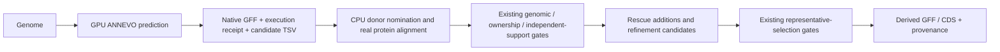

# ANNEVO candidates in rescue and refinement

ANNEVO's independent genome prediction can supplement missing-gene rescue and
existing-locus refinement. This is opt-in; original GFF/CDS/genomes stay unchanged.
Predictions are candidates, not independent biological support or calibrated
annotation-confidence scores.



## Prepare and connect

Run [ANNEVO genome annotation](annevo-genome-annotation.md) once. Each species
exports `output/genome_prediction/annevo/SPECIES/candidate_inputs.tsv`. This
table contains `species`, `gff`, `receipt`, in that order. For several species,
combine their rows under one header; do not rename species or overwrite sources.
Paths must be accessible inside the same GG container, and relative paths are
resolved against the table's directory.

An existing native prediction can export the same table:

```bash
python workflow/support/annevo_gene_models.py \
  --species Aethionema_arabicum --genome /data/genome.fa \
  --gff /data/native.gff3 --receipt /data/native_prediction.json \
  --output /data/annevo_candidates.tsv
```

Set `gene_model_annevo_inputs` in the input-generation entrypoint, or use:

```bash
GG_INPUT_GENE_MODEL_ANNEVO_INPUTS=/data/annevo_candidates.tsv \
GG_INPUT_RUN_GENE_MODEL_RESCUE=1 \
GG_INPUT_RUN_GENE_MODEL_REFINEMENT=1 \
  bash workflow/gg_input_generation_entrypoint.sh
```

The independent `rescue_gene_models.py plan` and `gene_model_refinement.py plan`
commands also accept `--annevo-inputs`. Refinement inherits a frozen ANNEVO table
when consuming a completed rescue publication; an explicit table is revalidated
against the current sources. Blank input leaves ordinary prediction unchanged.
The rescue/refinement workers consume GFF/receipts and need no GPU or ANNEVO
installation. Scheduler resources remain explicit and unchanged.

## Admission and restart

- Import only successful GG native GPU prediction receipts for the qualified
  Magnoliopsida profile and nuclear genetic code 1. Freeze table/GFF/receipt
  hashes with the plan; verify them at fresh boundaries and before publication.
- The prediction must use the target assembly. New native receipts additionally
  bind sorted contig names, lengths and DNA sequence hashes, allowing gzip,
  description, wrapping, ordering and letter-case differences without allowing
  changed contig names or bases. Legacy receipts require exact input bytes.
- Compare native coding paths only inside existing nominated intervals or
  bounded real miniprot placements. Measure protein identity and reciprocal
  coverage against the actual donor; apply the existing coverage/identity
  thresholds and alignment/candidate-size bounds. No score is fabricated from
  ANNEVO agreement or an available model.
- Keep existing ORF/start/stop, phase, splice, ambiguity, protected-exception,
  copy/ownership and independent-species checks. Unanchored placements retain
  their two-species minimum; several predictors/isoforms from one species count
  once. Split/merged or conflicting loci remain proposals.
- Existing intact loci retain `rna_required` representative admission by default.
  Accepted candidates and chosen representatives remain separate decisions.
  Whole coding RNA paths use the existing `gene_model_refinement_rna` interface;
  missing expression in the sampled tissues is not a gene-loss call.

`annevo_candidates.json` records nominations and unexamined native paths. Native
source/model/receipt identities and measured alignments stay in prediction
evidence. Derived GFF records `prediction_engine=ANNEVO` and native transcript
IDs. Accepted models use existing stable rescue/refinement identifiers, not
native IDs as extra independent loci. Previous miniprot prediction caches can
be reused; cached ANNEVO rows are re-nominated from the currently selected GFF so
an old cache cannot silently enable this backend or borrow obsolete support.
Use a new output directory after changing a frozen plan or scientific settings.

## Annotation-masking validation

`workflow/benchmarks/benchmark_annevo_masked_models.py` compares the existing
admission rules with and without native ANNEVO candidates. It uses an independent
reference GFF, actual donor CDS/proteins and real miniprot placement. Genomic DNA
and the fixed ANNEVO prediction stay unchanged; only reference annotations are
masked. No reference annotation is relabelled as RNA evidence.

The first real-data test used Aethionema arabicum CoGe genome 37218, its first
1 Mb of `lcl|LG-1`, 178 complete-envelope annotated loci (175 intact coding
loci), and donor CDS from Arabidopsis thaliana TAIR10.1 and Capsella rubella
Caprub1_0. Three seeds each hid 43 complete genes or one frame-changing internal
exon in 26 genes. Native ANNEVO predicted this same DNA on an RTX 6000 Ada;
admission comparison ran in the GG Docker development runtime.

| Exact reference coding-path recovery/admission | Without ANNEVO | With ANNEVO |
| --- | ---: | ---: |
| Whole-gene masks, 129 trials | 29 | 51 |
| Exon masks, 78 trials | 24 | 41 |
| Intact reference loci admitted for representative replacement | 0 | 0 |

Trials across seeds overlap and are not counts of distinct genes. These numbers
measure candidate admission; final representative adoption also has its ordinary
selection/margin gates. Controlled runtime tests separately execute rescue,
inherited refinement, finalization and GFF/CDS QC, including strand reversal,
pseudogene/stop/gap protection, source preservation and stale-input rejection.

Nonexact admitted candidates also increased: 15→19 at hidden-gene loci and 6→18
at exon-masked loci across the seeds. These differences need evidence review;
reference absence/difference is not definitive biological error. Off-reference
additions are reported as unknown, not true or false positives. This interval
test does not establish whole-genome uniqueness, unseen-species generalization,
complete isoform discovery, or annotation accuracy for all plants. The packaged
profile covers flowering plants; other plant groups need separate qualification.

Reproduce with source-bound input paths and a new private output directory:

```bash
bash workflow/tests/run_in_runtime.sh python \
  workflow/benchmarks/benchmark_annevo_masked_models.py \
  --genome /data/target.fa --reference-gff /data/reference.gff3.gz \
  --annevo-gff /data/native.gff3 --receipt /data/native_prediction.json \
  --donor-cds Arabidopsis_thaliana=/data/Arabidopsis_thaliana.cds.fa.gz \
  --donor-cds Capsella_rubella=/data/Capsella_rubella.cds.fa.gz \
  --cpus 4 --output workspace/output/new_annevo_mask_comparison
```

The report binds source SHA-256 values, parameters, donor commands and seeds.
Keep actual source files and detailed runs in private/workspace data storage;
do not commit downloaded biological data or local logs.
