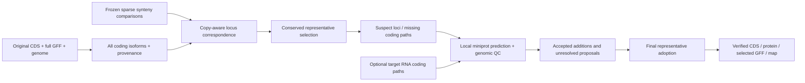

# Synteny-guided gene-model refinement

GeneGalleon can preserve all annotated coding isoforms, select corresponding
isoforms across species, revise incomplete existing models, and add supported
coding paths. This is opt-in. Ordinary input generation and longest-CDS behavior
remain the default.

The scientific design and related methods are described in the
[design plan](synteny-gene-model-refinement-plan.md). The implementation is an
experimental conservative annotation aid. Its score cutoffs are ranking rules,
not calibrated probabilities or estimates of annotation accuracy.

Prediction homology uses the rescue coverage/identity policy by default:
90% coverage with 50% identity, or 70% coverage with 70% identity. The configured
hard coverage/identity floors remain binding. This does not change RNA adoption,
independent donor, copy/span, score-margin or positive-gain gates for replacing a
representative. See [rescue homology support](gene-model-rescue.md) for fixed
cutoff compatibility and the separate coding-path integration criterion.

Original annotations using complementary frame fields are interpreted as GFF3
phases only when the same annotated coding path is bound to an agreeing source
CDS. The interpretation retains source fields and sequence hashes; generated
GeneGalleon paths and unsupported or ambiguous phase conventions remain strict.
Frozen rescue publications can be consumed after a downstream helper update:
their schema, plan, source inputs and dependency receipts are still verified,
while producer execution continues to require its own recorded tool identities.

## Workflow

### Re-evaluate UTRs after coding-model completion

UTR interpretation is automatic during finalization. CoGe annotations whose
`exon` rows encode terminal noncoding segments separately from CDS rows are
recognized only with matching CoGe feature identity, unique parents, terminal
segments and consistent declared transcript bounds. Their exon path is the
union of those segments and the unchanged CDS. Other inconsistent exon paths
remain unsupported, with an explicit audit reason.

Native UTR donors are assigned by unique exact CDS first, then a unique identical
nonempty full coding intron chain, then unique same-strand coding overlap.
Shared chains and multi-locus coding paths remain ambiguous. The UTR audit
distinguishes ambiguous overlap, opposite-strand overlap, absence of coding
overlap and contigs without native predictions.

To apply a corrected interpreter without rerunning coding selection or BUSCO,
use a separate derivative publication:

```bash
python workflow/support/gene_model_refinement.py reproject-utrs \
  --source-output /path/to/completed/refinement_output \
  --source-receipt-sha256 SHA256_OF_EFFECTIVE_RECEIPT \
  --output /path/to/new/utr_reassessment \
  --species Species_name
```

Repeat `--species` for a subset or omit it for the source cohort. Consumed source
members and native prediction provenance are freshly verified against frozen
receipts, with input-change fences through publication. The new `effective/`
contains selected, analysis and full GFFs, transcript FASTA, UTR audits, a summary
and provenance. Coding rows are checked byte-for-byte against each source GFF;
CDS/protein FASTAs and BUSCO results remain in the immutable source publication.
The summary denominator is the final exported CDS gene set, not all candidates.
This UTR-only derivative is not a replacement coding-input manifest.

Reassessment also recognises prior GeneGalleon-derived UTR children when the
source has gene-owned CDS rows without a separate transcript row. Those ends
are removed from the coding seed before independently evaluating the original
annotation and frozen native prediction again. Independent original UTRs are
not inferred from generated-looking identifiers or removed on that basis.

Completion builds one command-local contig-length lookup rather than scanning
the FASTA reference tuple for every donor and UTR end. In a synthetic fragmented
assembly benchmark (1,500 genes, 16,307 contigs, pysam 0.23.3, Linux ARM64),
one warmup and three timed runs gave median 1.104 s before and 0.131 s after.
The rendered GFF, audit and transcript sequence digest was identical. This is
a completion-kernel measurement, not whole-cohort or filesystem throughput.

Identical invocations verify and reuse the derivative. A different source,
species selection or UTR implementation requires a new output directory.



1. **Catalog:** reconstruct every annotated nuclear coding transcript from the
   exact genome and GFF; retain source transcript identity, gene ownership,
   unpadded CDS, phase, protein, quality and source hashes. Missing phase may be
   inferred only for a unique intact genomic ORF bound to an agreeing source CDS;
   unknown and conflicting phases remain separate quality states. UTR-only transcript
   differences retain their identities. Organelle paths follow the existing
   exclusion policy and remain in a separate audit. Original files are immutable.
2. **Selection:** freeze gene-level correspondence from verified existing rescue
   comparisons or an explicit correspondence table. Compare reciprocal protein
   coverage, identity, coding splice positions/phases and independent target
   evidence. Optimize deterministic connected components with a bounded
   multi-seed coordinate heuristic; it does not guarantee a global optimum. Select one record per
   locus, preserving all paralog/WGD copies. Conflicting copy correspondence,
   weak margins, candidate limits and possible genuine internal-exon loss cause
   abstention and retention of the source representative.
3. **Revision/addition:** predict only nominated loci and donor coding paths in
   bounded genomic windows. A locus omitted from the anchor set can acquire
   correspondence between two conserved flanks when bounded gene counts/order
   and independent protein similarity agree. Predictions must have the correct
   locus/strand, canonical splice sites, consistent phases, genomic start/stop,
   sufficient protein coverage/identity and no frameshift, internal stop or
   assembly ambiguity. Overlap with another locus remains a proposal. Explicitly
   reviewed merges of consecutive fragments can be published through the split-model interface.
4. **Effective inputs:** retain original transcripts in `full_annotation`, add
   accepted paths with stable assembly/coordinate/phase/CDS-derived IDs, and
   publish a selected GFF with the exact transcript behind every representative.
   The self-contained genome copy preserves the supplied gzip bytes. Consumers
   use the genome path in `effective/inputs.tsv` and expand it in scratch when
   their tools need an uncompressed FASTA.
   Selected transcripts receive [longest projected UTRs](oriongeno-genome-annotation.md#longest-projected-utr-per-side) from existing annotation and optional OrionGeno predictions; original exon/UTR metadata stays archived. CDSs of
   unresolved biological negatives remain unchanged; unusable translations are
   excluded from the analysis protein FASTA with an explicit admission audit.
   An unexplained source-CDS/genome disagreement or unreconstructible locus is
   excluded from the effective sequence/GFF view with `effective_exclusions.tsv`;
   exact supplied CDS bytes and original annotation remain in `source_cds` and
   `source_annotation`. GTF relationships are made explicit in selected GFF3.
   Accepted additions may extend the derived gene bounds, recorded in
   `gene_bounds_changes.json`; source annotation remains unchanged.

A primary-only CDS FASTA is sufficient when the supplied GFF retains all coding
transcripts and the exact genome is available. If the GFF itself has already
removed alternative transcripts, the catalog cannot recover their identities or
UTR metadata; supply the full original annotation via the explicit input TSV.

Gene-only FASTA headers are associated with the uniquely possible coding
transcript even when its supplied sequence disagrees with the genome. That
disagreement excludes the reconstructed candidate; it is not hidden by treating
the source record as unbound. When no transcript explains a gene's supplied CDS,
the unresolved candidates are withheld and the exact source record is archived.
Two explained formatter conventions retain genomic DNA without editing the
supplied record. A leading `NNN` envelope and additional 5-prime sequence are
recognised only when the remainder and the exact genomic CDS are suffixes of
the same annotated exon transcript, with consistent CDS phases and no genomic
internal stop or protected exception. This records exon coordinates, sequence
hashes and removed prefix length; it does not invent a start or terminal stop.
Same-length differences consisting only of `N` versus an uncertain IUPAC symbol
are recorded as uncertainty masking. Resolved-base changes and disjoint symbols
remain mismatches. Genomic ambiguity remains in the DNA, and its translation is
withheld. `partial`, `ambiguous` and `valid_orf` remain separate admission flags.
If several transcript identities share one exactly matching genomic coding path,
the source coding path remains the selection baseline without claiming a unique
transcript identity. A longer, unsupplied isoform does not silently replace it.
That unique source coding path can also supply missing phase evidence when the
genomic ORF is complete and all known phases agree. Its transcript identities
remain ambiguous, its original blocks are retained, and the inference basis is
recorded separately. Partial ORFs, distinct genomic paths with equal DNA,
conflicting phases and translation/annotation exceptions remain unresolved.

Two donor isoforms from one species count as one donor. Homology-only additions
at an already intact locus remain nonrepresentative until target RNA supports
the whole coding path by default (`isoform_adoption=rna_required`). The opt-in
`conservation_supported` policy permits accepted homology-only additions to
enter conserved representative selection. Adoption still requires its score
margin, independent donor species and copy/span safeguards, plus a strictly
positive gain in the cross-species protein/junction score against the final
adopted neighbors. A length/ORF quality improvement alone is insufficient. This
does not claim target RNA support or establish isoform expression.
A supported repair of an incomplete original can become
representative after the independent selection gates. An accepted candidate is
therefore not automatically the chosen representative. True species-specific
isoforms, pseudogene annotations, translation exceptions and genomic disruptions
are protected.

A supplied-CDS mismatch can be repaired without changing the coding coordinates
when exactly one owned original path has an intact, strictly genome-valid ORF
under a known genetic code, and at least two distinct trusted external donor
species support that same path (or the configured higher minimum). Prediction
coverage, identity, phase, splice, exception and collision checks still apply.
Self support and two reference groups from one species do not count as two
independent species. Unsupported mismatches, partial paths and normal source
models retain their existing gates.

This DNA consistency repair is counted as a model revision, including when the
gene has another normal isoform. It preserves the gene and source transcript
IDs and reuses the original structural transcript. Exact original CDS/GFF bytes
remain archived. A repaired source representative is marked `sequence_repaired`;
an already selected normal alternative is retained. Final selection flags and
counts agree, while the original graph decision, metrics and affected selected
flags remain in a separate audit. Repair does not resolve paralog correspondence,
assign orthology or expected copy, or establish target RNA support. These remain
unassigned when the graph is ambiguous; intact genomic DNA alone is insufficient.

Translation follows GeneGalleon's existing context-free codon-table convention:
alternative initiator codons retain their ordinary residue, such as TTG → L
and GTG → V. This does not interpret complete-CDS initiation context. A path
containing an in-frame dual-coding stop codon (including its terminal codon)
is retained as DNA/annotation but withheld from comparative, protein and coding
analysis admission with `translation_uncertain`; whole-path RNA support does
not override this unsupported translation context.

The first predictor backend is miniprot. The existing missing-gene rescue
workflow's optional GeMoMa backend remains available separately; the new
existing-locus refinement does not invoke it. No new predictor/container
installation is required.

Verified native ANNEVO GFF/receipts can supplement these candidates with
`gene_model_annevo_inputs` (`--annevo-inputs` for the independent planner).
Donor support is measured independently and all existing adoption gates remain;
see [connection, provenance and masking comparison](annevo-model-improvement.md).

## Use the same fixed donors for rescue and refinement

Use one frozen donor-only rescue plan for the cohort and a separate rescue
and refinement output directory per target. The panel specifies exact CDS,
GFF, genome, BUSCO and genetic code inputs. See
[preparing a fixed rescue donor panel](gene-model-rescue.md#fixed-donor-panel).

For a genomic target, complete rescue with `--donor-plan /path/to/panel`
first. Refinement takes the same donors and the verified target-to-donor
synteny comparisons from the rescue publication. The target never serves as
its own donor, even when it is a member of the panel.

```bash
python workflow/support/gene_model_refinement.py plan \
  --rescue-output /path/to/targets/Genus_species/rescue \
  --output /path/to/targets/Genus_species/refinement
python workflow/support/gene_model_refinement.py run \
  --output /path/to/targets/Genus_species/refinement --cpus 4
```

For a target that has assembled transcripts only, use the same panel and
select its isoform FASTA from the standard assembly directory. A one-species
`--transcriptome-inputs` manifest from `prepare-transcriptome` also works.
DIAMOND compares the target to the fixed donor proteins using the same
reciprocal-match and ambiguity rules as the existing sequence-only mode.

```bash
python workflow/support/gene_model_refinement.py plan \
  --donor-plan /path/to/panel --target Genus_species \
  --transcriptome-assembly-dir /path/to/transcriptome_assembly \
  --output /path/to/targets/Genus_species/refinement
```

Run it with the same `run` and `qc` commands as for a genomic target. Both routes
publish selected CDS/protein inputs in `effective/sequence/inputs.tsv`; only
genomic targets also publish `effective/inputs.tsv` with GFF and genome. For
a genomic target with RNA evidence, the existing `--rna-bam-dir` or `--rna`
interface accepts whole coding paths aligned to that genome. The sequence-only
FASTA route does not turn assembly contigs into genomic coordinates.

The donor representative stays fixed to the source baseline. Other annotated
donor isoforms remain available to nominate local genomic predictions. The
usual independent support and adoption checks still run on the target.
Donor catalogs, DIAMOND databases, protein comparisons and identical local
miniprot searches are cached by inputs and tool identity under
`gene_model_refinement_donor_cache/` next to the panel. Keep the panel, caches
and completed target directories available when adding targets. A new
target does not invalidate existing results. A revised target or panel
requires a new output directory; unchanged donor artifacts can still be reused.
Shared-cache publications are serialized across compute nodes using atomic
filesystem namespace operations, including when Lustre is mounted with
`localflock`. Finish older jobs before sharing a cache with the current
implementation. An interrupted writer can leave a lock with an owner record in
the cache's `.locks` directory. Inspect it with `shared_namespace_lock.py inspect`
and reconcile it only after the workspace's users have stopped.
When targets have separate parent directories, set
`GG_INPUT_GENE_MODEL_RESCUE_COMPARISON_CACHE` (CLI `--comparison-cache` on
`run`) to one shared directory to reuse matching genomic comparisons across
revisions as well.

The input-generation entrypoint accepts
`GG_INPUT_GENE_MODEL_RESCUE_DONOR_PLAN=/path/to/panel` and, when discovering
an assembly-only target, `GG_INPUT_GENE_MODEL_REFINEMENT_TARGET=Genus_species`.
Use a separate workspace or explicit per-target output paths; a fixed-panel
refinement publication contains one target.

## Run from input generation

Set `run_gene_model_refinement=1` in
`workflow/gg_input_generation_entrypoint.sh`, or use a scoped override:

```bash
GG_INPUT_RUN_GENE_MODEL_REFINEMENT=1 \
  bash workflow/gg_input_generation_entrypoint.sh
```

Without explicit raw inputs/correspondence, the stage reuses
`gene_model_refinement_rescue_dir` or the configured `gene_model_rescue_dir`.
If no plan exists there, it prepares the existing sparse donor/synteny plan using
formatted CDS/GFF/genome, comparable first-pass BUSCO summaries and the initial
species tree. Configure `gene_model_rescue_tree` and donor/reference parameters
as for [missing-gene rescue](gene-model-rescue.md). A completed comparison is
reused only when its frozen source/tool/receipt contract verifies.

When the same rescue directory contains a completed, verified `augmented`
publication, refinement uses those CDS/GFF inputs, retaining rescued missing
models in the final representative set. Species genetic codes come from the
frozen rescue plan. Combined array runs prepare the refinement plan after
rescue finalization; a plan frozen before augmentation must use a new refinement
output directory. Explicit `--inputs` and `--rescue-output` are mutually exclusive.

Important settings:

| Variable | Default | Meaning |
| --- | --- | --- |
| `run_gene_model_refinement` | `0` | Enable the new stage. |
| `run_gene_model_rescue_swissprot` | `1` | Audit missing-gene rescue candidates with the existing Swiss-Prot DB and use protein support for lower rescue bars. |
| `gene_model_rescue_swissprot_dir` | blank | Separate evidence publication; default is the frozen rescue directory's sibling `.swissprot`. See [candidate evidence](gene-model-evidence.md#candidate-only-swiss-prot-support). |
| `gene_model_refinement_policy` | `conserved` | `longest` or `conserved`. |
| `gene_model_refinement_isoform_adoption` | `rna_required` | `conservation_supported` allows homology-only additions when cross-species consistency improves; requires `conserved` selection. |
| `gene_model_refinement_mode` | `conservative` | `off` skips prediction; `audit` retains prediction proposals; `conservative` accepts only supported predictions. |
| `gene_model_refinement_dir` | blank | `output/input_generation/gene_model_refinement`. Use a new directory for changed inputs/settings/implementation. |
| `gene_model_refinement_inputs` | blank | Optional original species CDS/GFF/genome TSV, paired with `gene_model_refinement_edges`. |
| `gene_model_refinement_transcriptome_inputs` | blank | Assembly coding isoforms and their gene assignments, paired with `gene_model_refinement_edges`. |
| `gene_model_refinement_rescue_dir` | blank | Explicit frozen synteny plan to reuse. |
| `gene_model_refinement_rna` | blank | Target whole coding RNA-path evidence TSV. |
| `gene_model_refinement_accession_rna` | `auto` | Discover `refinement_accession_rna/inputs.tsv` under workspace inputs, or use the configured manifest. Blank disables discovery. |
| `gene_model_refinement_rna_bam_dir` | `auto` | Discover RNA BAMs under the workspace input directory, or use the configured directory. Blank disables discovery. |
| `gene_model_refinement_assembly_dir` | `auto` | Discover standard transcriptome assembly output. Blank disables discovery. |
| `gene_model_refinement_split_model_merges` | blank | Reviewed split-model candidates from a completed rescue publication. |
| `gene_model_refinement_model_repairs` | blank | Reviewed single-locus candidates from a completed rescue publication. |
| `gene_model_refinement_min_margin` | `0.10` | Experimental score margin for adoption. |
| `gene_model_refinement_min_support` | `2` | Independent donor species for cross-species acceptance/adoption. |
| `gene_model_refinement_candidate_limit` | `32` | Exceeding the selection limit abstains; prediction does not silently truncate alternatives. |
| `gene_model_refinement_padding` | `2000` | Local window padding in bp. |

Prediction coverage, identity, maximum interval and intron limits use the
existing `gene_model_rescue_*` settings. Representative adoption separately
requires reciprocal protein coverage ≥0.75 and aligned identity ≥0.35, as well
as its margin and donor gates. These distinct comparisons are not accuracy
estimates. The new output namespace does not replace rescue
outputs or install files into curated `workspace/input`.

### Automatic OrionGeno CDS extensions

In conservative mode, a native OrionGeno CDS can extend a single unambiguous
source model when the two paths belong to the same locus. The extension must
add at least 90 coding bases and 20% of the source CDS length, retain at least
90% of the source CDS in frame, and produce a genomic ORF with validated start,
stop, phases and splice sites. For a partial source CDS, it must preserve any
validated source terminus. When neither source terminus is known, at least
95% of the source CDS must remain in frame.

At least two external donor species (or the configured minimum, if greater)
must support both the retained and added portions of the OrionGeno CDS.
When the source already encodes a complete ORF, the new path also requires
at least two distinct, whole-CDS target RNA witnesses. Whole-CDS RNA support
for the original candidate or a competing qualifying repair holds the
extension. Accepted extensions preserve the locus ID and appear in
`effective/model_repairs.json`.

### Automatic split-model merges

In conservative mode, refinement adopts a unique split-model candidate when
two or more external donor species support the same complete genomic CDS.
Each fragment must be usable, and the candidate must preserve at least
two-thirds of each incomplete fragment in frame. If one source model has a
complete ORF, the merged CDS must preserve it in full and extend it in frame.
For the external-donor route with a complete source ORF, a frozen OrionGeno
transcript must match every CDS boundary and phase. The source fragments must
align to ordered, disjoint regions of each supporting donor protein.

A second route uses a complete, independently annotated copy at a different
locus in the same genome. It applies to two single-exon source models when the
upstream model lacks a stop codon and the downstream model has a complete ORF.
One complete genomic CDS must contain both originals in frame. The intervening
segment must encode at least eight amino acids and align contiguously with its
flanks to the reference copy, with at least 75% identity in the intervening
segment. The whole alignment requires 90% coverage of each protein and 80%
identity, as well as the configured homology checks. This route uses a
within-species comparison and a conserved coding bridge as evidence.

Refinement also searches native OrionGeno paths that span adjacent source CDSs,
including loci absent from the rescue split publication. A path must preserve at
least two-thirds of each usable source CDS in frame. It can recover missing
coding regions beyond those CDSs when a single protein per supporting donor
species aligns across at least 90% of the length of both proteins with at least
50% identity. At least 80% of the projected codons from each source fragment
must align to a donor residue. The configured coverage minimum also applies to
the proportion of paired residues across the two proteins. The configured
homology and independent-species minimums also apply. This search
uses the frozen rescue donor panel or the original proteins of the input
genomes when running refinement directly.

For a completed rescue, refinement uses the verified `native_split_candidates`
publication when the annotation, OrionGeno input and homology settings match.
The rescue `split-candidates` command can recreate that publication from
existing rescue outputs.

Genomic ownership, splice and ORF checks apply to every route. An original CDS
with usable translation, a start, an in-frame stop and no initial phase offset
counts as complete even if its GFF record carries a partial flag.

Two or more complete source ORFs can be joined when two external donor species
project the same genomic coding path. A full-length donor alignment must cover
the junction between consecutive fragments. Each source peptide must align to a
distinct, ordered part of that donor, and at least 90% of its aligned residues
must survive in the joined CDS. At least two species must pass these protein
checks. Unique full-length fragment hits to separate collinear genes within
10 kb in a donor hold the join. Refinement can disregard such a pair when
all corresponding intervals place both hits elsewhere, at least three species
project the joined CDS from the same protein that supports both source fragments,
and two of those proteins lie within conserved flanks. For competing joins
of exactly the same source genes, these positive checks can identify one path
when all qualifying projections for every rival come from outside its flanks. The same residue checks apply to joins
retaining less than 80% of any source CDS in frame. Every fragment must retain
at least two-thirds of its coding bases. In the absence of matching projections,
OrionGeno joins of complete ORFs require at least 80% in-frame retention and
two distinct target RNA molecules spanning the joined CDS. An observed complete
original transcript holds the join in either route. Competing paths and protected
annotations remain unresolved.

`effective/split_model_merges.json` records the adoption basis and the matching
OrionGeno transcripts or source reference locus. RNA-supported merges also
record the whole-CDS witness count.

### Automatic resolution of fused gene models

With native OrionGeno predictions in conservative mode, refinement can replace
one selected original CDS with two independently supported genes. Each
non-overlapping prediction must have a complete ORF of at least 100 amino acids, preserve at least 80% of
its own coding bases in frame in the source CDS, and explain at least 10% of the
source CDS. Together the predictions must explain at least 85% of the original
CDS in frame, with one original splice junction that connects the two regions.
The automatic route requires a single original model without protected
annotation.

For each replacement, its best qualifying protein hit in each donor must have at
least 45% identity, 65% coverage on both proteins and 60% of the longer protein
paired to a residue. In at least two donor species (or the configured
independent-species minimum, if greater), the hits must be to distinct genes on
the same chromosome and strand, in the same transcriptional order, within 10 kb.
A pair 10–100 kb apart can also contribute when both genes are consecutive
in the representative annotation. This route requires at least three donor species,
no opposing fusion hit, and consecutive pairs inside conserved flanks in at least
two species. Each outer anchor is within 500 kb of its target boundary and the
corresponding donor interval spans at most 1 Mb. The eligible donors must occupy at least two different sister branches along
the target lineage. At the nearest ancestor with informative donors, at least
one donor must support the split. A source-like full-length donor annotation
is recorded as opposing evidence. Donors with unresolved support for both
architectures do not count towards split support. If the nearest informative group contains both
architectures, refinement holds the candidate for review. For runs with
rescue synteny, refinement examines the existing flanks of opposing hits when
enough donor species have collinear split copies. Two conserved flanks must
identify a unique corresponding interval to classify a hit. A donor with all
spanning hits outside the interval can be excluded as opposing evidence. Two
split-supporting species and a fusion annotation within the corresponding
interval trigger review. Independent accession RNA can confirm the split in
this case. Two whole-CDS RNA witnesses for a fusion within that interval hold
the split even when the donor is more distant.

A nearest donor whose fusion model is supported by at
least two matching whole-CDS RNA witnesses in `--rna` holds the candidate for
review. A qualifying lower-scoring isoform of the same donor locus can
also supply this RNA evidence. RNA from a different paralog cannot veto
the split through the representative donor hit.

Refinement shares one DIAMOND search per target species across native
merges, terminal extensions and splits. Each decision reads only its own
query hits. Splits that overlap another proposed edit are still held for
review.

Refinement reuses the rescue guide tree. A guide generated by BUSCO/RapidNJ
is midpoint-rooted for this comparison. For a direct-input run, supply a
rooted Newick with `--species-tree`; `gg_input_generation` forwards the
configured `taxonomy_species_tree` for direct genomic inputs. A run lacking a
species tree reports candidates for review. Competing splits or model edits
also leave the locus unresolved.

If target RNA is available, refinement checks candidates supported by
comparative evidence or held for conflicting nearest donors. The same indexed
BAM pass checks for a primary, strand-matched read spanning the intact CDS,
including its fusion splice, and for reads spanning the exact diagnostic
junction. Duplicate read names across BAMs count once.
The same path can be supplied via `--rna` with
counts from independent molecules. One whole-CDS witness holds the split for
review and two or more support retaining the fused model. Two primary
RNA fragments with distinct alignment extents, MAPQ of at least 30 and at
least 16 aligned bases on each side of the exact splice also hold the split
for review. A missing RNA input or zero validated witnesses contributes no
evidence to the decision.

#### RNA evidence from another accession

Supply `--accession-rna inputs.tsv` to the refinement planner, or configure
`gene_model_refinement_accession_rna`. The tab-separated manifest has one row
per evidence accession and uses the target's existing species identifier.
Each row configures the data files and provenance for the entire accession.

```tsv
species	target_accession	evidence_accession	gtf	protein	rna_sources
Solanum_lycopersicum	Heinz 1706	M82	TomatoRTD_transfix.gtf.zip	TomatoRTD_transfeat_coding_pep.zip	SJ:isoseq&rnaseq
```

Paths are relative to the manifest or absolute. The GTF needs exon rows with
quoted `gene_id` and `transcript_id` attributes. Each protein FASTA ID must
identify the corresponding GTF transcript. Files can be plain text, gzip,
or ZIP with a single GTF or FASTA inside. The comma-separated `rna_sources`
values name the GTF column-2 labels that document independent RNA support.
Use transcript-supported sources, with accession identity and labels checked
against the provider's metadata.

RNA from another accession can resolve a split supported on different sister
branches when donor annotations conflict.
Both validated replacement proteins must match full-length proteins exactly
at a unique pair of loci in the other accession. The matching RNA-supported
transcripts must be nonoverlapping, on the same contig and strand, and in the
same transcriptional order within 10 kb. An RNA-supported transcript with
exons in both matched models, or a full-length supported fusion, leaves the
conflict unresolved. Target RNA retains priority. Donor species remain the
units of comparative support.

When comparative split support is sparse or confined to one sister branch,
the accession evidence also requires two flanking genes. Among the nearest ten
representatives on each side, the closest qualifying protein must be unique in
the target and map to a single RNA-supported accession locus. The two accession
flanks must bracket the candidate on one chromosome within 1 Mb, in either order.
The same check can identify a projected join or a longer CDS. Each join needs
two independent donor projections and at least two-thirds in-frame retention per
fragment. A longer CDS requires projections from two species assigned to the source
locus by synteny or reciprocal protein matching, at least 90%
in-frame retention and a gain of at least 15 residues and 10% of the source protein.
A supported original protein at the corresponding accession locus, a target RNA
witness for the original CDS, or replicated target reads at a lost splice hold
the repair. Competing CDS paths for identical source loci can be resolved if
exactly one path matches. Distinct CDS paths encoding the same matched protein
remain ambiguous. Existing adoption records include the accession transcripts
and the flanking genes used for these decisions.

The representative CDS, protein, and GFF views publish the two new genes.
`effective/fused_model_split_decisions.json` records split and fusion support,
the nearest informative donors, and the decision for each tested candidate.
`effective/fused_model_splits.json` gives the accepted IDs, source splice
coordinates (zero-based, half-open), OrionGeno transcripts, and CDS hashes.
Source views retain the input annotation. The check reuses rescue protein and
coordinate inputs without rerunning whole-genome Miniprot.

A completed rescue run can supply its augmented annotation, existing native
predictions, and verified synteny comparisons to a fresh refinement plan.
Refinement verifies comparison receipts and member bytes under the frozen
rescue plan before consulting its own comparison backend. A comparison
missing from an older rescue backend can be restored with the source and
plan that produced that run.

### Reviewed split-model merges

Review `rescued/<species>/split_model_candidates.json` from a completed rescue
run with split-model support, including donor support and alternative candidate
paths for the same fragments. Each candidate links two or more consecutive
fragments through one complete donor-supported genomic CDS. Rescue can search
incomplete and copy-ambiguous matches through its bounded whole-genome fallback.
Candidate placement flags and competing structures warrant review before
changing the locus count.

Make a tab-separated file with columns `species` and `candidate_id`, with one
row for each approved candidate. Use a fresh refinement output directory and
set `gene_model_refinement_split_model_merges` to that file and
`gene_model_refinement_rescue_dir` to the completed rescue directory. The CLI
equivalent is:

```bash
python workflow/support/gene_model_refinement.py plan \
  --rescue-output RESCUE_DIR --output REFINEMENT_DIR \
  --mode conservative --split-model-merges reviewed_merges.tsv
python workflow/support/gene_model_refinement.py run --output REFINEMENT_DIR
```

Refinement freezes the review table and rescue candidate publication. It
rejects duplicate approvals, shared source genes and paths whose ownership or
genomic CDS fails revalidation. The approved model replaces all its fragments in
the representative CDS, protein, transcript, GFF and analysis views. The
original models remain in the source and full annotation views.
`effective/split_model_merges.json` records all original owners and their
retired representative IDs. Use `effective/inputs.tsv` for downstream analysis.

### Automatic single-locus model repairs

In conservative mode, refinement reads the verified rescue publication and
selects a unique genomic coding path when two or more independently anchored
reference species support it and the path passes current homology, ownership,
splice and ORF checks. For an intact source CDS, the path must preserve all
existing coding bases and their reading frame while extending the CDS. For a
partial source, it must preserve at least two-thirds of the coding bases in
frame and keep an annotated start or stop at its original coordinate.
When syntenic anchors are unavailable, rescue can use unambiguous reciprocal
protein matches. In that case the adopted path must retain all the original
coding bases and their reading frame while extending the CDS. Refinement keeps
competing supported paths unresolved.

Refinement also corrects conflicting numeric CDS phases when one source
transcript has the same complete CDS in the supplied FASTA and the genome.
It preserves that transcript ID and CDS coordinates. Automatic changes are
recorded with their evidence in `effective/model_repairs.json`. The standard
rescue and conservative refinement commands use this behavior without target
or approval tables.

#### Repairing individual coding isoforms

Default conservative refinement compares each proposed CDS with the source
transcripts at its genomic locus. It considers shared splice junctions,
in-frame coding overlap and matching termini. A revision must match one
source coding path unambiguously. Transcripts with identical CDS coordinates
and phases can share a revision while keeping their own IDs and UTRs.
Protected source annotations and proposals that overlap a conflicting locus
remain unresolved. A phase-only correction applies to an individual
transcript only when its CDS rows can be edited independently.

An accepted new coding path gets a transcript ID under the original gene in
`effective/full_annotation/`. The original transcripts remain there.
Admission requires a verified genomic ORF and qualifying homology from at
least two other species (or the configured minimum if higher). The evidence
must also support the change through a conserved CDS gain, a donor-supported
native extension of a partial transcript, whole-CDS target RNA, or a matching
RNA-derived translation at a uniquely anchored locus in another accession.

The representative map and downstream FASTAs keep one sequence per gene.
A unique repair of the current transcript can become representative when
the source is partial or the revised path has direct RNA evidence.
RNA evidence for both paths preserves the original representative.
For unresolved paralog correspondence, promotion of that transcript requires
whole-CDS target RNA or accession RNA together with independent syntenic
projections. A directly supported revision of a different transcript can
replace the current representative when it wins the configured representative
comparison. The existing `model_repairs.json` records the original transcript
IDs, changed CDS blocks and whether the repaired transcript became representative.

### Reviewed single-locus model repairs

Rescue writes `rescued/<species>/model_repair_candidates.json`. Coding-path
candidates cover a single existing coding locus and may extend a CDS terminus
or change its exon boundaries. Phase-only candidates have identical coding
coordinates and conflicting numeric source phases. The publication includes
donor coverage and identity, placement flags, CDS blocks and a CDS checksum.

Put the reviewed `species` and `candidate_id` pairs in a TSV. Use
`gene_model_refinement_model_repairs` with a completed
`gene_model_refinement_rescue_dir`, or plan with the CLI.

```bash
python workflow/support/gene_model_refinement.py plan \
  --rescue-output RESCUE_DIR --output REFINEMENT_DIR \
  --mode conservative --model-repairs reviewed_repairs.tsv
python workflow/support/gene_model_refinement.py run --output REFINEMENT_DIR
```

Refinement rechecks genomic ownership, splice sites, phases, translation and
the CDS checksum. Coding-path repairs require at least two independent donor
species that meet the refinement homology thresholds, or more if configured
by `gene_model_refinement_min_support`. Phase-only repairs require one
independent donor and an exact match to the supplied CDS. Coding-path repairs
retain the gene ID and add a transcript. Phase-only repairs also retain the
source transcript ID. The source inputs are archived and
`effective/model_repairs.json` records the adopted paths.

Slurm submission uses the existing array helper:

```bash
python workflow/gg_input_generation_array.py \
  --task-plan workspace/output/input_generation/tmp/task_plan.json \
  --refinement --max-running 8 --cpus 4 --memory 32G
```

This prints the submission plan. Add `--submit` to submit it. The order is initial
finalize/plan, sparse comparison and catalog workers, correspondence/selection,
species prediction workers, then final export/QC. `--rescue --refinement` also
runs missing-gene rescue. `--retry` rejects active refinement workers before
submitting and rechecks idempotent stage receipts; it never treats a receipt
filename alone as completion. Predictor CPU/memory/concurrency can use the
existing `--rescue-cpus`, `--rescue-memory`, `--rescue-max-running` settings.

## Standalone and restartable CLI

Run these commands in the GeneGalleon runtime, from the repository root:

```bash
python workflow/support/gene_model_refinement.py plan \
  --rescue-output /path/to/current-frozen-rescue \
  --output /path/to/refinement --policy conserved --mode conservative
python workflow/support/gene_model_refinement.py run \
  --output /path/to/refinement --cpus 4
python workflow/support/gene_model_refinement.py qc --output /path/to/refinement
```

Stages can also run independently: `catalog`, `correspondence`, `select`,
`predict`, `finalize`, `status`, `qc`. Catalog/prediction workers accept
`--task-index` in frozen species order. Only complete stages are published, with
source/tool/dependency/content receipts and locks. A failed attempt retains its
diagnostics. Modified frozen inputs or implementation fail rather than using
stale predictions.
`qc` checks every required publication against the current frozen dependency
graph, including missing stages. A copied effective input TSV must match its
published bytes; changing species membership or genetic codes is not permitted
by retaining the sequence hashes.

During correspondence, each species' rescue sources and completed prepared
publication are read in full once within a command-local verification scope.
Repeated comparisons check the two participating species' file identities,
resolved paths and permissions. All used proofs are checked before publication
and at command exit; a later command reads the bytes again. Initially damaged
prepared outputs retain the ordinary locked recovery/rebuild policy, but a
change after successful verification aborts rather than refreshing the proof.
Mutable comparison outputs still receive full content verification, and each
new intermediate publication also checks its participating species immediately
before publication. Comparison keys, donor order and biological gates are
unchanged. The scope does not persist stat-authorized checksums between runs.

For an externally reviewed graph, `plan --inputs sources.tsv --edges edges.tsv`
avoids rebuilding synteny. Paths in `sources.tsv` may be relative to that table;
columns are `species`, `cds`, `gff`, `genome`, `genetic_code` (default 1).
`edges.tsv` requires `species_a`, `gene_a`, `species_b`, `gene_b`; optional fields
are `weight` (0–1], `evidence`, `ambiguous`. Gene IDs are the catalog's formatted
locus IDs, not transcript IDs. Supplied correspondence is an explicit research
input, not automatically an orthology truth set.

RNA evidence columns are `species`, `seqid`, `strand`, `cds_blocks`,
`transcript_id`, `count`. `cds_blocks` is a JSON list of zero-based, half-open
coding intervals in transcript order. The entire coding path must agree with
one target transcript. A collection of individually supported junctions does not
establish co-occurrence. The same full-path requirement applies to RNA BAMs. Place genome-aligned RNA BAMs in
`workspace/input/refinement_rna_bam/` for input generation, or use
`--rna-bam-dir` with the standalone CLI. Use `<species>.bam`,
`<species>.<sample>.bam` or `<species>/<sample>.bam`. The workflow verifies
the BAM reference dictionary and available sequence checksums, and generates
an index in its own output if needed. A primary alignment with MAPQ at least
20 must cover every coding block and match the strand and complete splice
chain. Splice junctions must be encoded as CIGAR `N`. A strand-valued XS tag
or the unambiguous splice orientation establishes the
strand. Evidence records identify the BAM and supporting read. Exact matching
paths from either input route support both existing annotated candidates and
new predictions. Paths are indexed once for matching; partial paths and separately
supported junctions do not strengthen a full transcript choice.

## Transcriptome assembly inputs

Input generation automatically discovers species without genomic inputs in
`workspace/output/transcriptome_assembly/assembled_transcripts_with_isoforms/`.
It prepares all CDS isoforms and their gene assignments from standard Trinity,
rnaSPAdes or RNA-Bloom2 outputs, using the corresponding Corset clusters for
RNA-Bloom2. The standalone CLI accepts `--transcriptome-assembly-dir` pointing
to the parent `transcriptome_assembly` directory. An explicit
`--transcriptome-inputs` manifest can still be supplied.

Without an explicit `--edges` table, DIAMOND compares baseline proteins for
species pairs that include a transcriptome. An inferred edge requires a
reciprocal best match with at least 80% coverage in each protein and the
configured minimum identity. The best hit must pass those thresholds after
ranking all reported matches. A second distinct hit within 5% of the best
score leaves the pair unresolved, even if that rival has lower coverage. The result supplies
sequence-only evidence for representative selection. Genomic prediction
uses the existing synteny correspondence.

Refinement can select existing coding isoforms in a cohort of transcriptome
assemblies, genome annotations, or both. For assembled cDNA, run this inside the
GeneGalleon runtime with the original `*_isoform.fa.gz` file.

```bash
python workflow/support/gene_model_refinement.py prepare-transcriptome \
  --assembly Genus_species_isoform.fa.gz --species Genus_species \
  --assembler trinity --output assembly_candidates --cpus 4
```

Use `--assembler rnaspades` for rnaSPAdes or `--assembler rna-bloom2` with the
matching `--corset-clusters` TSV for RNA-Bloom2. Use `--gene-map` in place of
`--assembler` for explicit assignments. The command extracts one CDS per
transcript with CDSKIT, preserving transcript IDs and identical CDSs belonging
to distinct transcripts or genes. It also writes a gene-level
`Genus_species_initial_longestCDS.fa` for initial orthology inference.

The resulting `assembly_candidates/inputs.tsv` has `species`, `cds`,
`transcript_gene_map` and optional `genetic_code` (default 1) columns. The optional
`transcript` column binds the source assembly FASTA for exporting selected
transcripts. You can also supply an existing per-transcript CDS FASTA and a
`transcript_id`, `gene_id`
mapping TSV directly. Every FASTA ID must have exactly one mapping. Use the
`GENUS_SPECIES_GENEID` format for gene IDs. The optional `baseline` column can
mark one existing representative per gene with `1`. Otherwise the longest input
CDS, with ties broken by transcript ID, supplies the baseline. When combining
manifests, resolve paths relative to the combined TSV or use absolute paths.

To use curated gene-level ortholog correspondences, provide a frozen
`edges.tsv`. Use columns `species_a`,
`gene_a`, `species_b`, `gene_b` and optional `weight`, `evidence`, `ambiguous`.
Mark unresolved copy assignments as `ambiguous`. An orthogroup can contain
multiple copies, so its membership alone is insufficient to establish edges.

```bash
python workflow/support/gene_model_refinement.py plan --output mixed_refinement \
  --transcriptome-inputs assembly_candidates/inputs.tsv \
  --inputs genomic_sources.tsv --edges edges.tsv --mode off
python workflow/support/gene_model_refinement.py run --output mixed_refinement --cpus 4
python workflow/support/gene_model_refinement.py qc --output mixed_refinement
```

Omit `--inputs` for a transcriptome-only run. To reuse a frozen rescue plan for
the genome species, use `--rescue-output` in place of `--inputs`. Refinement
then combines rescue synteny edges with the supplied ortholog correspondences.
The input-generation entrypoint accepts the same settings through
`GG_INPUT_GENE_MODEL_REFINEMENT_TRANSCRIPTOME_INPUTS` and
`GG_INPUT_GENE_MODEL_REFINEMENT_EDGES`, with `GG_INPUT_GENE_MODEL_REFINEMENT_INPUTS`
or `GG_INPUT_GENE_MODEL_REFINEMENT_RESCUE_DIR` for a mixed cohort.

Pairs involving an assembly use protein identity and reciprocal coverage, with
internal-gap safeguards and no splice-junction score. Changing an assembly
representative requires a positive conservation gain, sufficient independent
donor support, and the score margin. Unresolved copies and weak comparisons
keep their initial representative. Genome-based prediction and structural
outputs use genome-annotated species.

The complete cohort's paired FASTAs are in `effective/sequence/species_cds` and
`effective/sequence/species_protein`, with their genetic codes and manifest in
`effective/sequence/`. Use those sequence directories for sequence-based
analyses. `effective/sequence/representative_map.tsv` records the source
transcript, the initial transcript for assembly species, selection status and
admission to the FASTAs. The usual `effective/inputs.tsv` covers the subset with
genome and GFF inputs. When the source assembly FASTA is supplied, the selected
cDNA sequences are also written to `effective/sequence/species_transcript`
and listed in the sequence manifest. Both effective manifests support
[transcript-reference quantification](main-stages-and-what-they-do.md#quantify-selected-transcripts).

## Review figures

After `qc` succeeds, render a separate review directory in the same runtime:

```bash
python workflow/support/plot_gene_model_refinement.py \
  --output /path/to/refinement --report /path/to/refinement-review \
  --cds-dir /path/to/all-dataset-species-cds \
  --max-loci 200 --preferred-species Species_name
```

The helper verifies the consumed publication hashes, produces `summary.png`
and `summary.svg`, and embeds the summary and locus diagrams in a self-contained
`review.html`. The summary counts every native species. `--cds-dir` also includes
species without a matching genome/GFF in the plan, with grey rows marked
`not analysed` and unavailable counts instead of zero improvements. Their CDS
remains unchanged. The detailed gallery is bounded
by `--max-loci`, prioritizes the requested species and changed/accepted loci, then
fills remaining slots with prediction proposals. Search the gallery by species,
gene identifier or selection decision. `review_data.json` retains the report's
provenance and numerical inputs in the review directory.

Coding paths, affected loci and changed representatives are different counts.
The summary separately counts admitted representatives with resolved source
phases. These counts include the earlier unique-transcript inference and the
unique coding-path inference above; they are not predicted isoform additions.
The diagrams preserve genomic spacing and strand, label source and selected
paths, and expose phase, donor, RNA and rejection evidence. A source coding-path
label may refer to identical coding paths with unresolved transcript identity.
Whole RNA-chain support does not establish translation initiation or protein
function. Review files are never added to the immutable refinement publication.
Source coding-path phase resolutions can fill unused gallery slots. Their
original phase blocks and inference basis are available in the evidence panel.

When `run_species_busco=1`, input generation also evaluates the before/after
representative DNA CDS sets and writes `busco_comparison.png`, `.svg`, `.tsv`
and `.json` under `gene_model_refinement_dir.review/busco`. The review is separate
from the immutable native publication. Both evaluations use transcriptome mode,
e-value `1e-03`, limit 20, the same BUSCO/tool binaries and one local lineage
whose contents are hashed. The before set is the frozen refinement source,
including earlier rescued genes when supplied; the after set is selected
representative DNA, rather than all candidate isoforms or the admitted-only
protein view. Grey CDS-only species remain visible and are evaluated unchanged.
Exact unchanged input bytes reuse the corresponding evaluation. Per-species
receipts permit verified restarts; changed inputs, implementation or settings
require a new report directory. Failed or incomparable evaluations do not
produce a completed comparison. Deltas use integer BUSCO counts, avoiding
rounding errors in the displayed summary percentages.
Explicit protein assessment is available with `--mode proteins`. The default
`--protein-input-policy strict` translates declared frame-zero CDS and rejects
partial terminal codons, internal stops, invalid bases and duplicate identifiers.
`--protein-input-policy admitted` instead consumes completed native catalogues
and the exact effective protein/translation-admission publication. It preserves
the existing annotated-phase and usable/exportable admission rules, recording
every excluded source identifier and reason. Neither policy guesses a genetic
code: native codes come from the frozen plan and must agree with an optional
`--genetic-codes` TSV; CDS-only species require an explicit TSV entry.

The public `gene_model_refinement_busco.busco_version()` probe runs in a private
temporary working directory with a 30-second timeout and a child-only writable
Matplotlib cache. BUSCO initialises its logger even for `--version`, so the probe
does not depend on a writable scheduler package or home. Errors propagate without
retry, the scratch directory is removed, and the numerical evaluation/reuse
contract is unchanged. The probe verifies the directory owner and no-follow
descriptor, then establishes 0700 explicitly even when NFS inherits 0777.
Execution adapters should use this API rather than invoke
the tool from a sealed launch directory.

Completed admitted-protein evaluations can be reused across separate reports
with `--reuse-report /path/to/previous/busco --reuse-producer
/path/to/exact/gene_model_refinement_busco.py`. The producer file must match the
previous report's implementation hash. Reuse verifies its computational function
bodies, translation policy and parser/provider dependencies against the current
implementation, plus every numerical setting, tool/wrapper hash and lineage
content hash. Different physical lineage/download paths are permitted only
under those content identities. Identical protein bytes reuse verified scores
and full tables with a fresh current-DNA/admission receipt; changed proteins run
BUSCO again. Corrupt prior evidence fails verification rather than being imported.
The current source records every imported leaf and its original receipt hash.

The comparison also shows per-species missing-gene rescue counts and accepted
repair/additional-isoform coding paths. Rescue counts are unique gene features
with source `genegalleon_rescue` in the frozen annotation and are already included
in the before set. Coding paths are counted separately from gene loci; repair
and isoform paths can belong to the same locus. Unanalysed species show unavailable
counts rather than zeros. `model_change_summary.json` records these counts and
their source hashes. BUSCO stacks use the existing GeneGalleon palette: black
single-copy, firebrick duplicated, dark grey fragmented and light grey missing.
When the original completed rescue publication is available, rescued genes are
stacked in four support categories: Self species only, Nearest relatives only,
Phylogenetically balanced references only, or Multiple groups (at least two).
The legend and explanatory notes spell out these groups. Graphical legends sit
directly below their corresponding BUSCO, missing-gene rescue, or coding-path
panels. Donor-group legends appear separately below each supported-model panel;
the Swiss-Prot legend stays below the rescue panel. Classification uses all consolidated
`support` records of each accepted model, deduplicates donor species, and counts
each gene locus once. A donor in both frozen reference lists supports both
types, so the multiple category does not require two distinct donor species.
Two donors from nearest relatives alone still count as Nearest relatives only. The four categories must sum to
the source GFF gene count, with matching accepted
model IDs and verified plan/model/augmentation receipts. Donor memberships and
per-gene supporting species are saved in `model_change_summary.json`.
Rescue model IDs can name gene or transcript features; explicit GFF `Parent`
links map transcript identities to gene loci without guessing suffixes.
Self-species support must belong to a frozen self-synteny comparison.
A locus supported by at least two of the three groups belongs to multiple, so each
gene appears once. Each bar's label shows the total across all four segments.
When donor groups are available, the accepted-coding-path panel shows two bars
per species: the upper bar partitions paths into repairs and additional
isoforms, and the lower bar partitions the same paths by supporting donor group.
The lower bar uses the rescue colours and frozen nearest/balanced lists. It
also includes an `Other interspecies only` segment for paths supported solely
by interspecies donors outside those lists and without self-species support, which can
occur through reverse correspondence edges. Only means exactly one donor group;
any additional unselected donors remain in the saved per-path evidence.
Self support means homology support from the target
species, not target RNA evidence. Counts use the recorded accepted prediction
`donors`, cross-check candidate support and alignments, and count each candidate
path once. Each lower bar must sum to the upper bar's repair plus isoform total.
`rescue_support_groups` and `accepted_path_support_groups` store the current
donor-group counts. Legacy `rescue_support_counts`, `rescue_self_only_loci`,
`accepted_path_support_counts` and per-model donor records remain unchanged in
`model_change_summary.json` for saved-data compatibility. Regrouping requires
complete per-model evidence; old aggregate counts cannot recover mixed self
support. Excluded species
remain unavailable in both panels. Historical summaries lacking donor groups
retain their original display when complete donor evidence is unavailable.
The rescue directory is inferred from the refinement plan. For imported explicit
inputs, supply `--rescue-output /path/to/original-completed-rescue`; its augmented
GFF hash must match the frozen source annotation. Historical inputs without
support evidence retain an unpartitioned total, rather than invented categories.
Each phase also retains a hashed `runs/SPECIES/before/full_table.tsv` or
`runs/SPECIES/after/full_table.tsv`, so lost, gained and duplicated BUSCO groups
can be investigated without repeating the predictor run. Summary and full-table
bytes are both checked when reusing cached results.
To validate and redraw an existing comparison without running BUSCO again, use
`python workflow/support/gene_model_refinement_busco.py --plot-only --report
/path/to/paired-busco`. This retains the original evaluation contract and also
supports earlier summary-only comparisons; changed input/score bytes are rejected.
Input CDS, saved contracts, receipts and score files stay within one fresh
verification boundary until drawing finishes, so concurrent changes also fail.
Relocating a report preserves the original summary paths as provenance; those
paths are not scores. Receipt hashes still bind every summary, and all counts,
tool and lineage metadata must match the original evaluation.
Add `--output /path/to/refinement` to this plot-only command to include rescue
and coding-path counts from that verified publication without rerunning BUSCO.
The report must remain outside the immutable refinement tree, including when
using `--plot-only`. Three-stage BUSCO and Swiss-Prot diagnostic legends also
sit below their corresponding panels, outside the data area.

The missing-gene panel also has two bars per species: upper, the same donor-group
support counts; lower, repeat overlap for the same rescued loci. The lower bar
partitions loci into any TE-labelled CDS overlap, other/unclassified repeat
overlap without a TE hit, assessed with no repeat overlap, or not assessed.
Each bar sums to the rescued-locus total; excluded species remain unavailable.
Swiss-Prot diagnostic counts must agree with those locus totals and the primary
support categories. The displayed thresholds are bound to the audit receipt;
historical audits without diagnostics show unavailable diagnostic fields rather
than retaining values from a previously loaded audit.
Missing annotation is hatched and never treated as a negative hit. These are
annotation-overlap categories, not confirmed TE origins or functional-gene calls.
Intronic-only repeats do not count as CDS hits. The existing BUSCO palette is
unchanged.

Supply `--rescue-evidence-dir /path/to/model_evidence` to either evaluation or
`--plot-only --output /path/to/refinement`. This reads the separate
`SPECIES/evidence.json` and `SPECIES/receipt.json` publications produced by
[the rescue evidence audit](gene-model-evidence.md). Saved audit records must
match the exact rescue model/worker/plan hashes, and accepted model IDs must
match every rescued source locus. Changed or partial audits fail; species with
no audit directory remain not assessed. Per-locus fractions, repeat classes,
audit hashes and `rescue_repeat_groups` are saved in `model_change_summary.json`.
Historical summaries without repeat evidence still show the second bar as
not assessed. This redraw executes neither BUSCO nor repeat annotation.

For an existing verified publication, the same comparison is available directly:

```bash
python workflow/support/gene_model_refinement_busco.py \
  --output /path/to/refinement --report /path/to/paired-busco \
  --cds-dir /path/to/all-dataset-species-cds \
  --lineage /path/to/busco_downloads/lineages/embryophyta_odb12 \
  --download-path /path/to/busco_downloads --jobs 2 --cpus 4
```

`jobs * cpus` is the total CPU allocation. Input generation respects the existing
`species_busco_parallel_jobs` and per-job memory budget. BUSCO complete scores
do not measure all model repairs or isoform improvements; inspect duplication
and the locus evidence alongside completeness.

### Compact method and UTR summary

The three-stage review writes the compact summary when the publication
includes rescue-method and UTR evidence. The order is missing-gene rescue,
model refinement, UTRs, BUSCO, and the two OMArk columns when the matching
comparison is available. The bars show counts. The labels to the right show
the percentage of final transcripts with UTRs, complete BUSCO groups,
detected conserved HOGs, and consistent full-length proteins. The last label
also gives the count of annotated protein-coding loci for that stage when
available. For a transcriptome assembly, this count is the number of loci
represented in the sequence set. The OMArk percentage uses the number of
representative proteins evaluated by OMArk.

For an already audited reporting summary, redraw the figure with:

```bash
python workflow/support/gene_model_improvement_plot.py \
  --figure-data /path/to/figure_data.json --output /path/to/new-figures \
  --omark-comparison /path/to/refinement.review/omark_comparison.tsv
```

This writes `busco_comparison.{pdf,png,svg}`, the consumed
`improvement_figure_data.json`, and `improvement_method_provenance.json`.
This redraw reuses saved BUSCO and OMArk results. Supply
`--gene-totals /path/to/gene_totals.tsv` with columns `species`, `stage`, and
`total_genes` for an older OMArk comparison that lacks annotation counts. Use
`input`, `rescued`, and `refined` as stage values. OMArk is omitted if the
comparison is absent. `--refinement-output` is optional when
the supplied summary already has audited method counts; when present, it
freshly verifies the frozen plan and prediction receipts and rederives the
three refinement method groups. The summary must declare that same plan's
SHA-256 in top-level `refinement_plan_sha256`; equal species and totals alone
are not a publication identity. Each accepted candidate ID counts once,
including distinct isoforms at the same locus. Rejected donor alignments and
Miniprot structural confirmation alone do not create a second nomination.
ANNEVO or imported rescue revisions without original nomination provenance
cannot be represented by these three groups and fail explicitly.

The optional input format is independent of cohort size and lineage group
count. It requires `mode` (`proteins` or `transcriptome`), positive integer
`groups`, and ordered, uniquely named `species` records:

| Field in each species record | Required meaning |
| --- | --- |
| `species`, `analysed` | Species label and a Boolean model-analysis status. |
| `busco` | `pre_rescue`, `before` (after rescue), and `after` (after refinement), each with integer `single`, `duplicated`, `fragmented`, `missing` summing to `groups`. An unanalysed species needs only `pre_rescue`. |
| `rescue` | `method_counts` for `synteny_based`, `miniprot`, `oriongeno`; `exclusive_intersections` with `+`-joined route names; `unique_loci` and `loci_supported_by_multiple_methods`. Optional `swissprot_support` partitions these same loci into `te_only`, `other_only`, `both`, `no_informative_hit`, `not_assessed`. All counts must reconcile to the same distinct adopted loci. |
| `coding_paths` | `repairs`, `isoforms`, and optional `architecture` containing `merges` and `splits`. The reporting snapshot can also retain audited nomination counts and colours. |
| `utr` | Positive `final_genes` (the number of exported coding transcripts); `sides` (`five_only`, `three_only`, `both`, `none`) and `origins` (`original_gff_only`, `oriongeno_only`, `both`, `none`), each summing to `final_genes`. These require independently audited source assignments. |

Unanalysed rows must set the three model fields to null. The top-level
`coding_path_legend` contains `labels` `["Miniprot only", "OrionGeno only",
"Both methods"]` and `colours` `["#a6cbe5", "#4b91c4", "#154f79"]`.
With `--refinement-output`, those method counts and legend are replaced from
the verified predictions; the supplied revision/isoform totals must still agree.
Donor-species support groups are a different measurement and are never relabelled
as predictor methods. This reporting snapshot is not a model-admission input.

The two Miniprot routes form one exclusive blue stack, OrionGeno uses a
separate green bar, and the lower stack gives Swiss-Prot annotation of
their combined loci. Historical inputs without Swiss-Prot counts show
that union as unassessed. The refinement column stacks CDS repairs,
merges, and splits in one bar with colour-matched counts underneath.
The UTR column shows transcript counts by ends and source. BUSCO and
OMArk show available stages from top to bottom in input, post-rescue,
and post-refinement order. The model panels display `Not analyzed`
for species that did not run genome model improvement.

Top-level reporting metadata can supply the dataset name. Use `--method-notes`
to print recorded thresholds below the plot. `busco_dataset` is the actual configured lineage name, for example
`embryophyta_odb12`. Copy `rescue_parameters` from the frozen rescue plan's
`request.parameters`; the displayed fields are `minimum_coverage`,
`minimum_identity`, `minimum_broad_coverage`, `minimum_lower_coverage_identity`,
`min_anchors`, `cscore`, and `max_interval`. `rescue_swissprot_evidence.parameters`
records `evalue`, `minimum_alignment` (paired residues), `query_coverage`,
`target_coverage`, and `score_fraction` from the matching audit. Missing threshold
metadata is labelled as unrecorded rather than filled with current defaults.
These are reporting inputs: plotting does not rerun searches or establish new
annotation provenance. Swiss-Prot protein support remains separate from genomic
repeat overlap and does not establish host function or absence of TE origin.
The existing BUSCO comparison and Swiss-Prot diagnostic interfaces remain available.

## Outputs and downstream use

`effective/inputs.tsv` binds paths, hashes and genetic codes for:

- `species_cds`, `species_protein`, `species_gff`, `species_genome`;
- `analysis_cds`, `analysis_gff`, `coding_admission.tsv.gz`: admitted coding paths
  with known first-phase bases and terminal incomplete codon bases removed;
  CDS coordinates and phases agree with the analysis sequence and protein;
- `representative_map.tsv`, with one explicit locus-to-transcript choice;
- `species_genetic_code.tsv`;
- `full_annotation`, `all_candidates`, `changes.json`, `translation_admission.tsv.gz`;
- `species_transcript`, `utr_audit/SPECIES.json.gz`, and `utr_summary.tsv` for projected representative UTRs;
- exact supplied CDS files in `source_cds`, decoded original GFF in
  `source_annotation`, `effective_exclusions.tsv`, `gene_bounds_changes.json`.

Admission and per-species UTR diagnostics use streaming gzip compression. The
decompressed TSV and JSON schemas stay the same. BUSCO protein preparation,
refinement review, and UTR reassessment also read receipted plain-text outputs
from previous runs.

Inspect `predictions/SPECIES/predictions.json` for accepted/proposed candidates,
reasons, donor support and `homology_only_predicted` versus `rna_path_supported`.
Donor alignment failures (`low_identity`, `low_coverage`) are retained per
alignment with `supports_path=false`. They neither supply independent support
nor veto a path supported by qualifying donors. Structural, translation,
ownership, correspondence and protected-annotation gates still veto adoption.
Repeated isoforms from one donor species count as one independent donor.
Catalogs include all coding paths, exact associated source CDS records and
source FASTA association audits. A provider convention that replaces only the
terminal genomic stop with `NNN` is recognized when the whole preceding sequence
agrees; internal masking and code-specific non-stop replacements remain
inconsistent. This does not edit source files. SQLite
indexes load sequences by component instead of simultaneously for every species.
Read-only connections hold a consistent SQLite snapshot; borrowed connections
retain their existing transaction behaviour. Isolated loci are streamed through
one cursor and still use the same single-locus decisions, avoiding one NFS query
per gene without changing copy-ambiguity gates or the component memory bound.
GFF relationship filtering computes fixed membership sets once per view,
retaining the same ancestors, descendants and source feature relationships.
Eligibility is computed once per invocation; optimization states and graph
weights are confined to the current component. Pairwise scores retain the same
alignment and floating-point scoring rules.
Components larger than 5,000 loci abstain; identifier/edge/result metadata still
scales with total input size. Alignment cells and pair-cache entries are bounded. Selection uses independent
quality plus a weighted mean of pairwise conservation per locus; margins do not
increase merely because a common reference has many neighbors. Donor sampling
is not phylogenetically/clade balanced, and margins are not calibrated confidence.

Use the complete verified bundle for downstream analyses:

```bash
GG_COMMON_REPRESENTATIVE_INPUTS=/path/to/refinement/effective/inputs.tsv \
  bash workflow/gg_genome_evolution_entrypoint.sh
```

The same common setting is supported by gene evolution, genome annotation,
fractionation bias and transcriptome CDS-reference quantification. Scoped
`REPRESENTATIVE_INPUTS` overrides are also registered. They route the selected
CDS/protein/GFF/genome together, use exact transcript choices and bind cache
provenance to the selection. An older CDS resolution from the original source
is not applied to the selected view. Changing the selection requires rebuilding
its affected derived artifacts under the normal stale-artifact policy.

Gene/genome evolution in CDS mode and genome annotation use the admitted
analysis CDS/GFF pair. The biological selected CDS/GFF retains original partial
boundaries and unusable biological negatives for auditing, RNA reference use
and nucleotide fractionation analysis. Protein mode supports per-species genetic
codes; analyses using a single codon model require one common admitted genetic
code and reject a mixed-code bundle. Pairwise dS uses the admitted coding DNA
and requires matching genetic codes.
Selected gene-ID queries and DIAMOND references use the admitted protein FASTA,
including partial paths and species-specific translations. Selected TBLASTN
references use admitted analysis CDS, with each species' genetic code and the
total admitted nucleotide database size for E-value calculation. Nucleotide
fractionation uses the biological CDS and a derived reader GFF whose locus IDs
match the FASTA; its receipt records the exact source transcript, coordinates,
map and parser/runtime identity. Original annotation is retained.

Family experiments can use a separate output directory/manifest; they do not
silently update a global representative set. There is no automatic installation
or publication step.
Selected sequence, synteny and CDS-resolution caches are separated by manifest
identity and sequence view. Use separate workflow output directories when
running different bundles against the same final analysis artifacts.
`verify-inputs` without a field checks every member of the publication. With a
field it verifies the supplied manifest against its publication receipt and
hashes the requested files. Layout fields verify the directories and shared
tables they return. For one exact file, use
`verify-inputs --inputs effective/inputs.tsv --field cds --species Species_name`.
Kallisto uses this lookup. Paired fractionation reads the requested species'
CDS, GFF and representative map, and BUSCO input pairing verifies the CDS role.
FASTA indices retain the decompressed UTF-8 byte total as private metadata for
selected TBLASTN database sizes. Existing indices receive one atomic rebuild
under `ensure`; public schema 2 manifests and extracted sequences are unchanged.

## Validation and performance

See [refinement validation measurements](gene-model-refinement-validation.md)
for commands, workload sizes, measured ranges and limitations. Generated truth
fixtures test exact exon restoration and preservation of biological negatives;
these are implementation evidence, not population-level precision estimates.
Real annotation admission and actual synteny/miniprot/reader behavior are tested
separately from pure selector performance.

## Explicit species profiles and genome staging

`GG_INPUT_GENE_MODEL_SPECIES_PROFILES` forwards a TSV to rescue and refinement;
both CLIs accept `--species-profiles FILE`. The first column is `species`.
Optional columns are `max_intron`, `max_interval`, `padding`,
`minimum_coverage`, `minimum_identity`, `min_support`, and `candidate_limit`.
Blank cells retain global defaults. Duplicate/unknown species, unknown columns
and invalid values fail. `min_support` and `candidate_limit` concern refinement.
Genetic codes use the existing genetic-code inputs. Profiles apply to target
prediction/validation, not synteny chaining or conservation selection.
File hashes and parsed overrides are frozen. A refinement plan using
`--rescue-output` inherits its profiles unless supplied another profile file.
There is no automatic plant/animal/fungus threshold switch.

Rescue publications use a single directory traversal and bounded parallel
SHA-256 verification, with at most the requested `--cpus` hash workers. Every
regular output retains its full content hash and before/after stat guards;
receipt schemas, diagnostic files, source checks and publication recovery are
unchanged. Finalization, QC and worker completion use the same CPU budget.
On 256 stratified real rescue intervals (1,280 output files), interleaved warm
verification runs under pipeline load gave median 2.58 s for legacy traversal
and 1.08 s for single-pass traversal with eight hash workers; every file hash
matched. This measures output verification, not whole-pipeline speed.

`GG_INPUT_GENE_MODEL_GENOME_INDEX_CACHE` sets an optional execution cache
(`GG_GENOME_INDEX_CACHE` for direct CLIs). Prefer local scratch sized for the
genomes processed. Uncompressed sources are linked; compressed genomes are
expanded once. Source bytes, indexer implementation, pysam/htslib, indexed FASTA
and index bytes are verified, including after use. Corrupt entries are rebuilt
under the stage lock. No indices are written beside source files. Without a
cache, staging uses local temporary storage. Prediction nomination precedes
indexing. Zero-window refinement skips staging; zero-candidate rescue still
streams contig lengths to validate annotation bounds. Final effective bundles
retain their self-contained genome copies.

Set `TMPDIR` to writable node-local storage visible inside the container to
build the rescue model store and both refinement SQLite indexes there. When
temporary storage and the output are on different filesystems, the workflow
copies the completed files to the output stage, verifies their SHA-256, and
publishes them using the existing stage checks. A single filesystem uses direct
staging. Size temporary storage for the largest model store or locus index per
concurrent task.
The final index copies the verified initial SQLite index and applies the
accepted predictions to that copy. This reuses the original catalog import
and preserves the initial index for restart and inspection.

## Comparing representative proteomes with OMArk

Input generation defaults to `run_species_omark=auto` and evaluates the
representative proteomes at refinement finalization when its runtime provides
both OMArk and OMAmer. Set `GG_INPUT_RUN_SPECIES_OMARK=0` to skip the assessment
or `=1` to require it. For a completed publication, run only the comparison
with the existing refinement directory and workspace:

```bash
GG_INPUT_INPUT_GENERATION_MODE=refinement_omark \
GG_INPUT_GENE_MODEL_REFINEMENT_DIR=/path/to/refinement \
bash workflow/gg_input_generation_entrypoint.sh
```

To evaluate input representatives before refinement finishes, select
`input_generation_mode=refinement_omark_baseline` and point
`gene_model_refinement_dir` at a plan with completed species catalogues.
Run one array task per species in plan order (`GG_ARRAY_TASK_ID`, starting at 1).
A previous catalogue for the same original inputs is also suitable. Each task
excludes that catalogue's newly rescued loci and caches only the input result.
Use the same OMArk database and cache for the final comparison. It derives the
representatives from the current catalogue and reuses matching protein sets.

The table at `<refinement>.review/omark_comparison.tsv` has one row per species
and evaluated stage. The input and rescued stages use the catalogue's baseline
transcript and its admitted translation, one protein per locus. The input stage
excludes loci appended by this rescue. Genomic targets without rescue and
CDS-only targets have input and refined rows. The refined stage uses the exact
published representative proteins, including the mixed cohort in
`effective/sequence/inputs.tsv`.

The table reports protein counts, taxonomically consistent full-length proteins
(count and percentage), fragment and partial counts across placements, the
selected clade, conserved HOGs and missing HOGs. The missing-HOG delta is
relative to input and is populated only for a matching clade and HOG
denominator. A stage with zero admitted proteins has empty HOG fields.
Each evaluated row links to OMArk's native summary.

Both workflows use `output/species_omark_cache` in their shared workspace.
To share results across workspaces, set `omark_cache_dir` to the same absolute
directory in both. Select the same database with `omark_db_path` (default
`auto`). With `run_species_omark=1`, genome evolution reuses matching results
and exposes the usual paths under `genome_evolution/omamer_search` and
`genome_evolution/omark` as links. Keep the shared cache accessible while using
these outputs. Previously generated local results retain the legacy workflow's
reuse policy.

Reuse matches species, protein IDs and amino-acid sequences, OMAmer database
content, the ETE taxonomy database used to select the clade, and tool versions
and executables. Record order, descriptions, wrapping
and a terminal stop are normalised before search. A CDS translation that yields
a different protein set gets its own result. Each distinct result is published
only when both tools succeed. Unchanged database and catalogue files use the
existing digest cache where file timestamps permit. The comparison consumes
the published locus catalogue and effective proteins, without replaying
predictors or checking genome and GFF contents.

## Three-stage BUSCO

Within each species, three thin horizontal stacked bars are ordered vertically:
before missing-gene rescue, after rescue, and after refinement. This layout is
also used by the combined improvement plot when all three phases are available.
The same BUSCO palette and per-panel legends apply; excluded species remain
visible and explicitly marked as not analysed.

The standard pipeline using completed rescue inputs also emits
`busco_three_stage.png/svg`: pre-rescue CDS, after missing-gene rescue, and
after refinement. Direct evaluation opts in with `--three-stage`. The original
rescue plan and augmentation receipts bind the pre-rescue input. All stages
use the same frozen BUSCO lineage, binaries, wrappers and predictor parameters.
`delta_rescue_complete` measures rescue; `delta_complete` remains the refinement
effect for backwards compatibility. Excluded CDS-only species are evaluated
unchanged in every stage and marked not analysed. Historical two-stage reports
remain renderable.

## Known-annotation holdout evaluation

`workflow/support/benchmark_gene_model_holdout.py` accepts a
`species,cds,gff,genome,genetic_code` TSV and optional species profiles. It
verifies exact CDS/genome agreement, selects reproducible single/multiple-exon
strata and records exact restoration, misses, inexact accepted paths and
additions in deliberate assembly-gap controls. Input/tool/implementation hashes,
seed and parameters accompany results. Exact-source proteins make this an
interval-prediction/admission benchmark; it does not estimate whole-cohort
discovery precision or test independent interspecies/RNA support. Reference
annotations supply comparison truth, not independent experimental validation.
